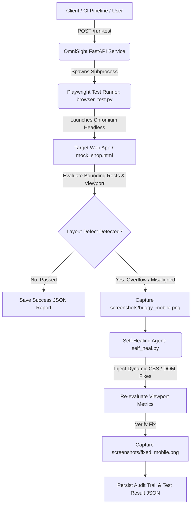

# OmniSight: Multimodal UI Self-Healing & RPA Agent 👁️🛠️

[](https://www.python.org/downloads/)
[](https://fastapi.tiangolo.com)
[](https://playwright.dev/python/)
[](https://opensource.org/licenses/MIT)

**OmniSight** is an intelligent, multimodal UI testing, visual defect detection, and automated self-healing Robotic Process Automation (RPA) agent. It continuously monitors web applications across target viewports, identifies layout regressions (such as button overflow and bounding-box clipping on mobile devices), executes runtime DOM/CSS self-healing patches, and records visual and structured proof of recovery.

---

## 🌟 Key Features

- **🔍 Automated Layout & Bounding-Box Inspection**: Emulates real-world mobile devices (e.g., iPhone 12/13/14 390×844) to detect horizontal overflow, off-screen elements, and misaligned call-to-action (CTA) buttons.
- **🩹 Dynamic Self-Healing Engine**: Evaluates broken layout metrics in real time and applies runtime compensatory CSS remedies (e.g., box-sizing recalculation, flexible width constraints) to restore full usability without manual downtime.
- **📸 Multimodal Visual Verification**: Automatically captures and stores full-page visual evidence (`screenshots/buggy_mobile.png` vs. `screenshots/fixed_mobile.png`) for auditability.
- **⚡ Developer REST API**: Powered by FastAPI with automated Swagger documentation, enabling CI/CD pipelines to trigger headless test suites and receive structured JSON logs.
- **📊 Historical Test Reporting**: Automatically persists execution output, success/failure flags, and timestamps to the `test_results/` repository.

---

## 🏗️ Architecture & Workflow



---

## 📂 Project Structure

```text
OmniSight/
├── api.py               # FastAPI server exposing test execution endpoints
├── browser_test.py      # Playwright test suite for mobile viewport layout validation
├── self_heal.py         # Autonomous self-healing script applying dynamic layout remedies
├── mock_shop.html       # Standalone testbed simulating an e-commerce checkout flow
├── requirements.txt     # Python dependencies
├── .gitignore           # Ignored environments, screenshots, and test artifacts
├── screenshots/         # Captured visual diffs (buggy vs. fixed states)
└── test_results/        # Timestamped JSON execution logs
```

---

## 🚀 Getting Started

### 1. Prerequisites
- Python 3.10 or higher
- Git

### 2. Clone the Repository
```bash
git clone https://github.com/kritikumari-bit/OmniSight.git
cd OmniSight
```

### 3. Create & Activate a Virtual Environment
```bash
# Windows
python -m venv venv
venv\Scripts\activate

# macOS / Linux
python3 -m venv venv
source venv/bin/activate
```

### 4. Install Dependencies & Playwright Browsers
```bash
pip install -r requirements.txt
playwright install chromium
```

---

## 🧪 Usage & Execution

### Option A: Run the UI Layout Bug Detector
Run the Playwright test script to inspect `mock_shop.html` on a simulated mobile viewport (390×844):
```bash
python browser_test.py
```
- If an element exceeds the viewport boundary, OmniSight logs `STATUS: FAIL` and saves a screenshot to `screenshots/buggy_mobile.png`.

### Option B: Execute Autonomous Self-Healing
Run the self-healing agent to inject runtime layout corrections and verify recovery:
```bash
python self_heal.py
```
- The agent calculates button bounding rects, applies safe box-sizing overrides, confirms that `scrollWidth <= clientWidth`, and outputs `screenshots/fixed_mobile.png`.

### Option C: Launch the REST API Server
Start the FastAPI server for remote or CI/CD-driven test executions:
```bash
uvicorn api:app --reload --host 127.0.0.1 --port 8000
```
- **Interactive API Docs (Swagger UI)**: Open [http://127.0.0.1:8000/docs](http://127.0.0.1:8000/docs) in your browser.

#### Available Endpoints

| Method | Endpoint | Description |
|---|---|---|
| `GET` | `/` | Service status welcome message |
| `GET` | `/health` | Health check endpoint |
| `POST` | `/run-test` | Triggers `browser_test.py` and returns structured JSON results |

#### Sample `/run-test` Response:
```json
{
  "timestamp": "2026-10-25T22:39:12.433641+05:30",
  "success": true,
  "output": "Checkout button details: {'width': 302, 'left': 44, 'right': 346, 'viewportWidth': 390}\nCheckout button fits within the viewport.\n",
  "errors": "",
  "result_file": "test_results/test_result_20261025_223912_434435.json"
}
```

---

## 🗺️ Roadmap

- [ ] **Vision-Language Model (VLM) Integration**: Integrate multimodal AI (e.g. Gemini 2.0 / GPT-4o Vision) for zero-shot semantic UI defect detection.
- [ ] **Automated GitHub Pull Request Generation**: Propose permanent code and CSS fixes directly via GitHub bots.
- [ ] **Multi-Device Matrix**: Expand automated testing across tablet, desktop, and varied mobile viewport profiles.
- [ ] **RPA Flow Automation**: End-to-end self-healing synthetic user journeys (login, form fill, cart checkout).

---

## 👤 Author & Contributions

Created with ❤️ by **[Kriti Kumari](https://github.com/kritikumari-bit)**.

Contributions, issues, and feature requests are welcome! Feel free to check out the [issues page](https://github.com/kritikumari-bit/OmniSight/issues).
